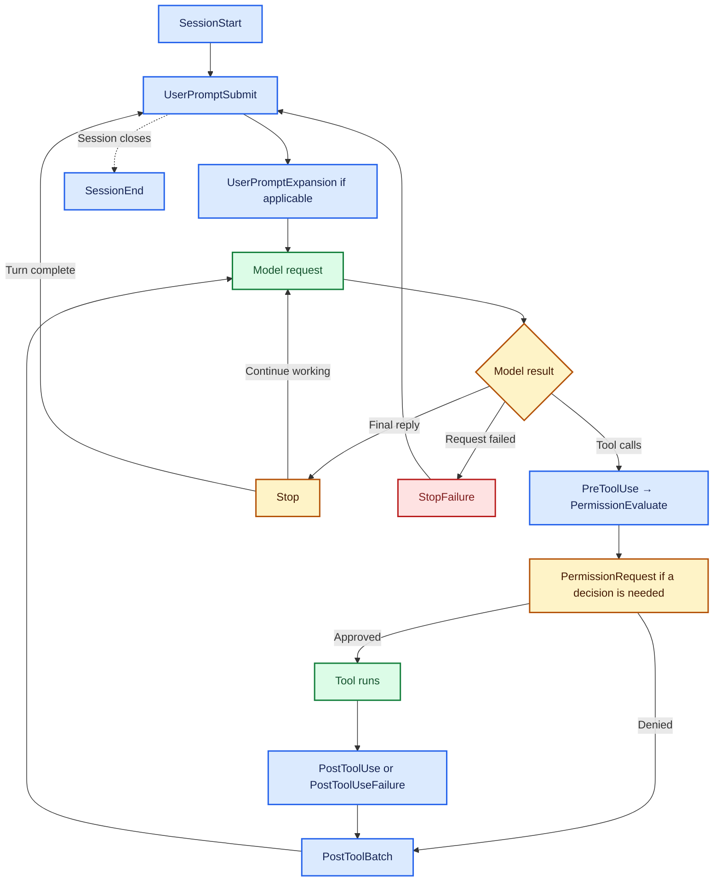
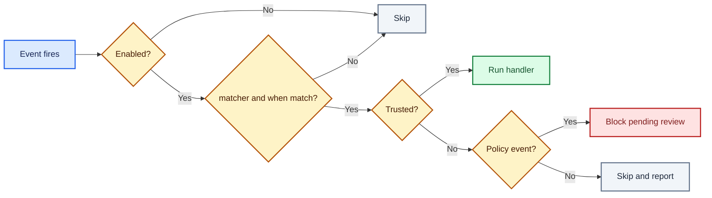
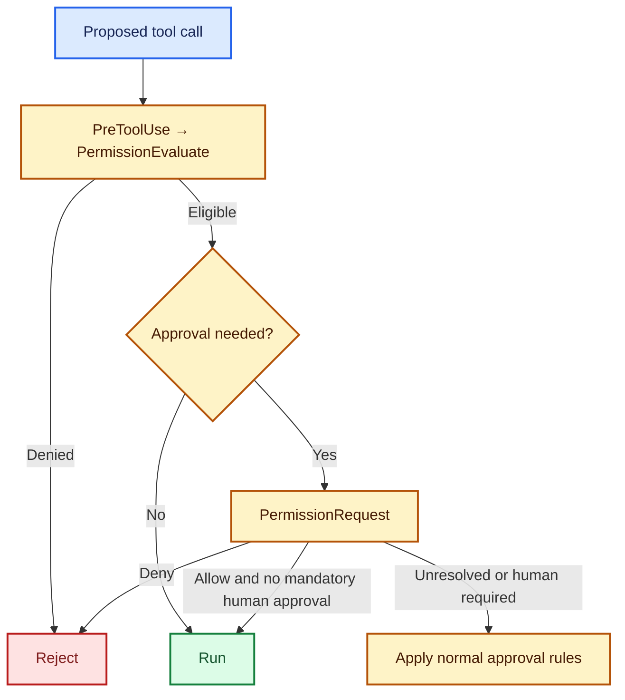
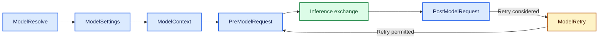
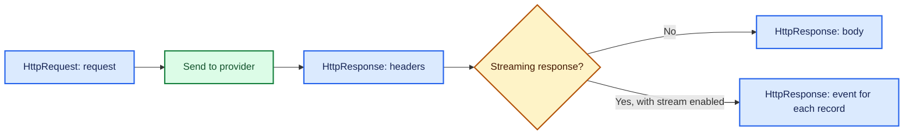

# Hooks reference

For setup and recipes, see [Automate actions with hooks](hooks.md).

## Core concepts

If you have used agentic coding tools before, you probably understand the
basics of hooks already. Synth's hook architecture maintains parity with
mainstream tools, but adds a specific focus on making it practical to combine
models with different capabilities in one workflow, with access and authority
tailored to each model’s role.

A request's **purpose** describes its job, whether that's agent work, approval
review, or compaction. A model's **tier** is the capability you assign it
(`small`, `mid`, or `frontier`). Its **trust** label describes where it runs
(`local` on your machine, `private` on infrastructure you control, or `hosted`
with a provider). A hook group's `when` filter can match any combination of
purpose, tier, and trust. See [model trust and tier](#model-trust-and-tier).

Suppose a small self-hosted model is implementing a change and you want a
frontier cloud model to answer a difficult design question. `ModelResolve`
can select the cloud route for that request. A `ModelContext` hook matching
`trust: "hosted"` can trim the request to the design details. When the
self-hosted model proposes a shell command, a `PreToolUse` hook matching
`tier: "small"` can require human approval before it runs.

## Hook lifecycle



Blue marks steps, amber marks checks, green marks progress, red marks blocks
or failures, and gray marks skipped hooks.

| Cadence | Entry points |
| --- | --- |
| Session | [`SessionStart`](#sessionstart), [`SessionEnd`](#sessionend) |
| Turn | [`UserPromptSubmit`](#userpromptsubmit), [`Stop`](#stop), [`StopFailure`](#stopfailure) |
| Tool call or batch | [`PreToolUse`](#pretooluse), [`PostToolUse`](#posttooluse), [`PostToolBatch`](#posttoolbatch) |
| Model request or attempt | [`ModelResolve`](#modelresolve), [`PreModelRequest`](#premodelrequest), [`PostModelRequest`](#postmodelrequest) |
| Workspace change | [`ConfigChange`](#configchange), [`CwdChanged`](#cwdchanged), [`FileChanged`](#filechanged) |

See [all hook events](#hook-events) for inputs and decisions.

### How a hook resolves

The event decides **when** Synth looks for hooks. `matcher` selects a value
from the event, such as the tool name. `when` narrows the match by agent,
request purpose, or model. Synth checks hook trust before running a matching
handler. Commands receive event JSON on stdin. MCP handlers build their tool
arguments from the same payload. The event determines which decisions the
handler can return.



### Model trust and tier

Use `trust` to describe where the model runs. Choose `local` for your machine,
`private` for a server you control, or `hosted` for a provider. Set `tier` to
`small`, `mid`, or `frontier` based on the model's capability for your work.
Set it to `unknown` to give a model with unassessed capability its own rules.
A project can use both labels to require human approval when a small or
mid-tier hosted model proposes a shell command.

If a model has no entry in `model_classes`, Synth uses `trust: "hosted"`
and `tier: "mid"` when matching hooks. Within an entry, omitted fields
use those same defaults. Filters for `small` or `unknown` match models
explicitly assigned those tiers.

Synth takes the first entry matching the model and, if specified, the
provider. Hook input exposes the labels as `model_trust` and `model_tier`.
For a routed request, `provider` is the route ID. This lets you classify two
deployments of the same model differently. The example uses a route named
`local-ollama`.

```json
{
  "model_classes": [
    { "provider": "local-ollama", "model": "qwen3:27b", "trust": "local", "tier": "mid" },
    { "model": "hosted-worker", "trust": "hosted", "tier": "mid" },
    { "model": "hosted-large", "trust": "hosted", "tier": "frontier" }
  ]
}
```

Add this filter to a [`PreToolUse`](#pretooluse) group whose handler returns
`permissionDecision: "ask"`. Keep the group's `hooks` array alongside these
fields.

```json
{
  "matcher": "^bash$",
  "when": { "trust": "hosted", "tier": ["small", "mid"] }
}
```

| Model proposing `bash` | Matches the filter? |
| --- | --- |
| `qwen3:27b` via `local-ollama` | No. Its trust is `local`. |
| `hosted-worker` | Yes. It is `hosted` and `mid`. |
| `hosted-large` | No. Its tier is `frontier`. |
| An unlisted model | Yes. It defaults to `hosted` and `mid`. |

Model classes affect matching. Synth still checks [hook trust](#workspace-trust)
and [tool permissions](#permissionrequest) independently. Apply a context policy
to each request that needs one, since local and hosted requests can draw on the
same conversation. `ModelResolve` runs before route selection takes effect.
`ModelSettings` and `ModelContext` see the routed model.

## Configuration

Each event maps to an array of groups. A group has a `hooks` array and
optional `matcher` and `when` fields. See a
[complete declaration](hooks.md#filter-by-agent-request-purpose-or-model).

### Hook locations

Synth appends definitions in this order.

| Order | Location | Shape |
| --- | --- | --- |
| 1 | [Synth's `config.json`](configuration.md#files) | Event map inside the `hooks` setting. |
| 2 | `~/.synth/hooks.json` | Event map or `{"hooks": {...}, "description": "..."}`. |
| 3 | `<project>/.synth/hooks.json` | Same standalone formats, relative to the original project root. |

Unknown event names and handler fields produce warnings. Wrap a flat handler
such as `{"command": "..."}` in a group as `{"hooks": [{"command": "..."}]}`.

### Matcher patterns

| Pattern | Matches |
| --- | --- |
| Omitted, `""`, or `"*"` | Every value. `FileChanged` needs explicit paths to watch. |
| `edit`, `write\|edit`, `code-reviewer` | Exact names. Use letters, digits, `_`, or `-`, with `\|` between alternatives. |
| `^mcp__docs__.*` | A regular expression. Use `^` and `$` when it should match the whole value. |

Events outside the table below ignore the matcher.

| Events | Matcher value |
| --- | --- |
| `PreToolUse`, `PermissionEvaluate`, `PermissionRequest`, `PermissionDenied`, `PostToolUse`, `PostToolUseFailure` | Tool name. |
| `SessionStart`, `ConfigChange`, `DirectoryAdded` | `source`. |
| `SessionEnd` | `reason`. |
| `Notification` | `notification_type`. |
| `SubagentStart`, `SubagentStop` | `agent_type`. |
| `PreCompact`, `PostCompact` | `trigger`. |
| `InstructionsLoaded` | `load_reason`. |
| `PreModelSwitch`, `PostModelSwitch` | `to_model`. |
| `StopFailure` | `error_type`. |
| `FileChanged` | Literal paths from the original project root, separated by `\|`. For example, `.envrc\|config/app.json`. |

Tool matchers accept both Synth names and the aliases `Bash`, `Read`,
`Write`, `Edit`, and `Agent` for `task`. For an MCP tool, match the
registered name, such as `mcp__docs__lookup`.

#### Filter by agent, request purpose, or model

Each field in `when` must match. Only `trust` and `tier` accept either one
value or a list of alternatives.

| Field | Values |
| --- | --- |
| `agent_scope` | `main`, `subagent` |
| `request_purpose` | `agent`, `approval_judge`, `compaction` |
| `agent_type`, `model`, `provider` | Exact string |
| `trust` | `local`, `private`, `hosted` |
| `tier` | `unknown`, `small`, `mid`, `frontier` |

See [model trust and tier](#model-trust-and-tier) for class declarations and
matching examples.

### Hook handler fields

| Field | Meaning |
| --- | --- |
| `type` | `command` (default) or `mcp_tool`. |
| `timeout_ms` / `timeout` | One per handler. Integer milliseconds or integer seconds, respectively. |
| `transcript` | With `true`, request a private JSONL transcript snapshot. Read the temporary path from `transcript_path`. |
| `onFailure` | Command hooks only. `block` or `continue` for an exit status other than 0 or 2. See [exit code output](#exit-code-output). |
| `async` | With `true`, run a command in the background where supported. |
| `stream` | With `true` on `HttpResponse`, also handle decoded stream records. |

Synth stores snapshots and large hook output in a private directory under
`$TMPDIR` when it is an absolute path. The fallback is `/tmp`.

#### MCP tool hook fields

Set `server` and `tool` to a connected server and its advertised tool name.
`arguments` (alias `input`) must resolve to a JSON object.

```json
{
  "type": "mcp_tool",
  "server": "project-policy",
  "tool": "check_edit",
  "arguments": {
    "file": "${tool_input.path}",
    "args": "${tool_input}",
    "origin": "synth:${session_id}"
  }
}
```

A whole-value reference preserves the original JSON type, so `args` above
is an object. A reference embedded in text produces a string. The connected
tool's response content must be empty or contain a hook output JSON object.

### Reference scripts by path

`command` runs in Bash without profiles, from `$SYNTH_PROJECT_DIR`
(also `$CLAUDE_PROJECT_DIR`). Resolve relative tool paths against the
payload's `cwd`, which follows `/cd`.

### The /hooks commands

| TUI command | Effect |
| --- | --- |
| `/hooks list` | Show definitions, filters, status, and recent runs. |
| `/hooks review` | Include the full declaration for review. |
| `/hooks trust <id>` | Trust a reviewed definition. |
| `/hooks revoke <id>` | Withdraw trust. |
| `/hooks enable <id>` | Re-enable a disabled hook. |
| `/hooks disable <id>` | Skip a hook. |

Use a full ID or a unique prefix with at least 32 characters for `trust` and
`enable`, and at least eight for `revoke` and `disable`. The same subcommands
are available as [`synth hooks`](cli.md#hook-review).

### Disable or remove hooks

Delete the handler from its source file to remove it. Trust and enabled
state are independent.

## Hook input and output

### Common input fields

Commands receive one JSON object on stdin. An abbreviated `PreToolUse` payload follows.

```json
{
  "hook_event_name": "PreToolUse",
  "session_id": "session-123",
  "turn_id": "4",
  "cwd": "/work/project",
  "agent_scope": "main",
  "request_purpose": "agent",
  "permission_mode": "ask",
  "provider": "ollama",
  "model": "qwen3:27b",
  "model_trust": "local",
  "model_tier": "mid",
  "tool_name": "Write",
  "tool_call_id": "call-1",
  "tool_input": { "path": "/work/project/note.txt", "file_path": "/work/project/note.txt", "content": "Draft" },
  "transcript_path": null
}
```

Use `session_id`, `turn_id`, `agent_id`, and `tool_call_id` to correlate
events. `tool_use_id` aliases `tool_call_id`. In `tool_name`, `bash`, `read`,
`write`, `edit`, and `task` appear as `Bash`, `Read`, `Write`, `Edit`, and
`Agent`, respectively. Other tools keep their registered names.
Event-specific JSON encoded as strings, such as `action`, `request_context`,
and `http`, needs a second decode. `tool_input` is already an object and
`tool_calls` on `PostToolBatch` is already an array.

### Exit code output

| Exit code | Effect |
| --- | --- |
| `0` | Empty stdout means no decision. Otherwise Synth parses stdout as one JSON object. |
| `2` | Blocks at policy gates and uses stderr as the reason. Observation events ignore the control effect. |
| `126` or `127` | Reports an unavailable command. |
| Other | Fails for request preparation, retries, and inference HTTP adapters. Other events continue by default. Use `onFailure` to override. |

Spawn errors, timeouts, and malformed JSON can fail synchronous policy gates.

### Timeouts

The global `hook_timeout_ms` defaults to 30,000. Set `timeout_ms` or
`timeout` per handler to override it, subject to the active operation's
deadline. `SessionEnd` and `Interrupt` default to 1,000 ms per handler and
cap each at 3,000 ms. `MessageDisplay` defaults to 10,000 ms when the global
timeout is at its built-in value.

### JSON output

Return `hookSpecificOutput` with the exact event name and its supported
fields. Use top-level `systemMessage` for a diagnostic.

```json
{
  "systemMessage": "Project conventions loaded",
  "hookSpecificOutput": {
    "hookEventName": "SessionStart",
    "additionalContext": "Use zig build test to verify changes."
  }
}
```

### Decision control

Look up supported decisions under each event. Where supported,
`continue: false` stops continuation.

## Hook events

### SessionStart

`source` is `startup`, `resume`, `clear`, or `compact`. Return
`additionalContext` for the model. Exit 2 blocks the first prompt or
continuation after compaction.

### InstructionsLoaded

Reports `file_path`, `memory_type` (`Project`), and `load_reason`
(`session_start` or `compact`) when workspace instructions load.

### UserPromptSubmit

Receives `prompt`. Return `additionalContext` for the model. Exit 2 or
`decision: "block"` with a `reason` rejects the prompt before it is saved
or sent to the model.

### UserPromptExpansion

Receives `prompt`, `command_name`, `command_args`, and `expanded_prompt`.
Exit 2 or `decision: "block"` rejects the expansion.

### MessageDisplay

Receives `message_id`, `index`, `delta`, and `final`. Return
`displayContent` to replace this display batch while the model retains
the original text. Slow hooks can delay rendered text while Synth keeps
reading the response. Complete lines waiting to be displayed can share a batch.

### PreToolUse

Receives `tool_name`, `tool_input`, `tool_call_id`, and serialized `action`.

| Output | Effect |
| --- | --- |
| `permissionDecision` | `deny` rejects, `ask` requires a human, and `allow` or `defer` leaves normal approval in effect. |
| `permissionDecisionReason` | Reason for `deny`. |
| `updatedInput` | Replace tool arguments before approval. Synth validates the tool schema and rejects conflicting rewrites. File tools accept aliases such as `file_path`, `old_string`, and `new_string`. |
| `additionalContext` | Add model context. |

Exit 2 or top-level `decision: "block"` also rejects the call.

```json
{
  "hookSpecificOutput": {
    "hookEventName": "PreToolUse",
    "updatedInput": { "command": "git status --short" },
    "permissionDecision": "ask"
  }
}
```

### PermissionEvaluate

Uses [PreToolUse](#pretooluse) input. Return `effect: "deny"` with a
`reason`, or `effect: "ask"` to require a human. `defer` and `allow` leave
normal approval in effect. Exit 2 rejects the call. Use synchronous handlers.

### PermissionRequest

Uses [PreToolUse](#pretooluse) input. Return `decision.behavior: "allow"`
for ordinary approvals, or `decision.behavior: "deny"` with a
`decision.message`. Exit 2 rejects the call.



Protected actions and explicit hook asks require a human in every
[approval mode](usage.md#auto-approvals). Headless mode refuses them,
even with `--allow`.

### PostToolUse

Receives tool fields, `tool_response`, and `duration_ms`. Return
`additionalContext` or, for MCP calls, `updatedMCPToolOutput` to supply
feedback alongside the recorded result. Blocks and failures report
diagnostics after the tool has run.

### PostToolUseFailure

Adds `error_message` and `is_interrupt` to the post-tool fields. Return
`additionalContext` alongside the recorded failure.

### PostToolBatch

Receives the `tool_calls` array. Return `additionalContext`. Exit 2 or
`decision: "block"` stops before the next model request.

### PermissionDenied

Receives the denied tool and automatic review's `error_message`.
`retry: true` invites the model to address the denial and propose a new call.

### Notification

Receives `message` and `notification_type`. Types include
`permission_prompt`, `agent_needs_input`, `idle_prompt`, `agent_completed`,
and `notice`.

### SubagentStart

Receives `agent_id`, `agent_type`, `parent_agent_id`, `parent_session_id`,
and `parent_tool_call_id`. Return `additionalContext` for the child.

### SubagentStop

Adds `last_assistant_message` and `stop_hook_active` to the subagent fields.
`agent_transcript_path` aliases `transcript_path`. Exit 2 or
`decision: "block"` asks the child to continue within its turn budgets.

### TaskCreated

Receives `task_id`, `task_subject`, `task_description`, and `tool_call_id`
before a todo is created. Exit 2 or `decision: "block"` rejects the update.

### TaskCompleted

Uses [TaskCreated](#taskcreated) input and decisions when a todo transitions
to done.

### Stop

Receives `last_assistant_message` and `stop_hook_active`, which marks a
turn already continued by a completion hook. Exit 2 or `decision: "block"`
with a `reason` asks Synth to continue within the turn budgets.
Use `continue: false` to finish the turn.

### StopFailure

Reports `error_type`, `error_message`, `last_assistant_message`,
`request_id`, and `attempt` when a model request fails the turn.

### Interrupt

Sets `is_interrupt: true` when the main turn is cancelled. See
[cleanup timeouts](#timeouts).

### ConfigChange

Reports `file_path` and `source` (`user_settings`, `project_settings`,
or `skills`). Synth watches `config.json`, user and project hook files, and
loaded skill definitions. The current trusted policy checks replacement hook
definitions. Exit 2 or `decision: "block"` can veto adoption while leaving
the edit on disk.

### CwdChanged

Reports `old_cwd` and `new_cwd` after the session changes directory.

### DirectoryAdded

Reports `directory` and `source` when a root is added, such as with
`/add-dir`.

### FileChanged

Reports absolute `file_path` and `event_type` (alias `event`), one of
`add`, `change`, or `unlink`. Use [literal paths](#matcher-patterns) in
the matcher to register watchers.

### PreCompact

Receives `trigger` (`manual` or `auto`) and
`request_purpose: "compaction"`. Exit 2 cancels summarization.

### PostCompact

Uses [PreCompact](#precompact) input after the summary is saved. Exit 2
stops continuation. To restore context, use a
[SessionStart hook](hooks.md#re-inject-context-after-compaction).

### PreModelSwitch

Receives `from_model`, `to_model`, `requested_model`, and `source`.
Exit 2 or `decision: "block"` vetoes the switch.

### PostModelSwitch

Reports `from_model`, `to_model`, and `source` after the model changes.

### SessionEnd

`reason` is `shutdown`, `clear`, or `resume`. Use synchronous command
handlers for [cleanup](#timeouts).

### ModelResolve

Receives `route`, `request_purpose`, and serialized `request_routes`.
Return a [route ID](configuration.md#models-by-request-purpose) allowed
for the current purpose. An empty `route` denies the request.

### ModelSettings

Reads the selected provider, model, and serialized `request_settings`.
Return `settings` using controls supported by the provider.

```json
{
  "hookSpecificOutput": {
    "hookEventName": "ModelSettings",
    "settings": { "temperature": 0.25, "max_output_tokens": 512, "attempts": 2 }
  }
}
```

Generation fields include `temperature`, `top_p`, `top_k`, `seed`,
`frequency_penalty`, `presence_penalty`, `stop`, `max_output_tokens`,
and `reasoning_effort`. Retry settings are `attempts` and `retry_delay_ms`.

### ModelContext

Receives `request_system`, `request_instruction`, and JSON strings
`request_tools` and `request_context`. Return `requestContext` with
`system`, `instruction`, a tool allowlist, or message edits by `seq`.
`contextEdits` also accepts message edits. Keep tool calls paired with
their results. Approval-review context is protected.

```json
{
  "hookSpecificOutput": {
    "hookEventName": "ModelContext",
    "requestContext": {
      "tools": ["read", "list"],
      "messages": [{ "seq": 42, "omit_images": true }]
    }
  }
}
```

### PreModelRequest

Reports `request_id`, `attempt`, `request_purpose`, `provider`, and `model`
at the start of a transport attempt.

### PostModelRequest

Adds `status` (`completed`, `failed`, or `cancelled`), `input_tokens`,
`output_tokens`, and `error_message` after a transport attempt.

### ModelRetry

Receives `attempt`, `http_status`, `error_type`, `error_message`,
`retry_allowed`, and `retry_delay_ms`. Return `retryAllowed` and
`retryDelayMs` (up to 60,000 ms) within transport limits.

### HttpRequest

Decode `http` for `phase: "request"`, method, URL, protocol, headers,
and body. Return a [request patch](#http-adapters).

### HttpResponse

Decode `http` for the response phase, status, headers, and payload.
Return a [patch for that phase](#http-adapters).

## Model requests

Use `when.request_purpose` to target agent turns, approval review, or compaction.
ACP's automatic session titler sends prompt and reply excerpts directly to the
session provider, outside these hooks and routes.



## HTTP adapters

Synth exposes inference HTTP exchanges for Chat, Responses, Messages,
and Ollama. The handler receives the exchange as a JSON string in `http`.
Known credential headers are redacted. The destination, model routing,
and approval-review evidence are protected.

| Event | Phase | Fields in `hookSpecificOutput.http` |
| --- | --- | --- |
| `HttpRequest` | `request` | `headers`, replacement JSON object `body` |
| `HttpResponse` | `headers` | `headers`, `status` |
| `HttpResponse` | `body` | replacement JSON `body` |
| `HttpResponse` | `event` | replacement JSON `body` or `drop: true` for an SSE or NDJSON record |

Set a header to `null` to remove it. Set `stream: true` on each
`HttpResponse` handler that needs individual stream records.



```json
{
  "hookSpecificOutput": {
    "hookEventName": "HttpRequest",
    "http": { "headers": { "x-client-purpose": "agent" } }
  }
}
```

## Run hooks in the background

This background command logs successful Bash calls.

```json
{
  "PostToolUse": [
    {
      "matcher": "^bash$",
      "hooks": [
        {
          "command": "jq -c '{tool_call_id, duration_ms}' >> .synth/shell-timing.jsonl",
          "async": true
        }
      ]
    }
  ]
}
```

Background handlers can deliver event-supported context and diagnostics
later. Keep blocking decisions, argument changes, and permission answers
synchronous. Async handlers are unavailable for MCP tool hooks,
`PermissionEvaluate`, `SessionEnd`, and the model preparation, retry, and
inference HTTP events.

## Security considerations

### Workspace trust

New hooks start enabled and untrusted. Command hooks run with your user
permissions, so review the code a hook will execute before trusting it.

#### Review a hook

1. Run `synth hooks review` from the project root, or `/hooks review` in
   the TUI. The report shows each hook's ID, source, and declaration. The
   CLI command works without running the hooks or connecting to a model.
2. Read the command and the scripts it invokes. For an MCP hook, check the
   server, tool, and arguments the hook sends.
3. Run `synth hooks trust <id>` or `/hooks trust <id>` for the version you
   reviewed. Use `disable` to skip a hook. Use `revoke` to withdraw trust
   while keeping its enabled state. See [hook commands](#the-hooks-commands).

Synth saves trust and enabled state separately by ID in your local
[`hook-trust.json`](configuration.md#files). Trusting a disabled hook leaves
it disabled. Enabling an untrusted hook still leaves it pending review.

#### What the hook ID covers

The ID includes the hook declaration and the contents of regular files Synth
can resolve directly from its command, including paths starting with `~/` or
`$HOME/`. For unreadable file references, the ID tracks the path and read
failure. A change in readability requires review.
Review indirect script dependencies and MCP server implementations separately.

Synth recomputes IDs when it reloads hooks, such as at the next prompt or
when you run `/hooks review` while idle. Editing a declaration or a tracked
script gives the changed hook a different ID. An ID with no saved state
starts enabled and untrusted, with its own review or disable decision.

Project hook IDs are scoped to the checkout. User hooks with an absolute
executable and absolute file arguments can share trust across checkouts.

#### What happens pending review

A matching, enabled policy hook can stop its operation pending review. For
example, an untrusted `PreToolUse` hook for `bash` blocks matching shell
calls. A matching untrusted `Notification` hook is skipped with a notice.
Disabled hooks are skipped, and unrelated events proceed. If a hook blocks a
prompt, resolve its review status and submit the prompt again.

File-tool writes to `.synth/`, `.git/`, Synth's active `config.json`, and
`hook-trust.json` require human approval. Shell calls follow their own
approval rules.

### Keep hook input scoped

Keep prompt text and tool input out of shell evaluation. Transcript
snapshots include message text and tool calls. Pass specific fields to
MCP tools that need them.

## Debug hooks

Use `/hooks list` for recent runs and exit statuses. Test a command from the
project root with sample JSON on stdin. The [path guard](hooks.md#block-edits-to-protected-files)
should exit 2 and print its reason to stderr.

```sh
printf '%s\n' '{"cwd":".","tool_input":{"path":".env"}}' |
  bash .synth/protect-paths.sh
```

