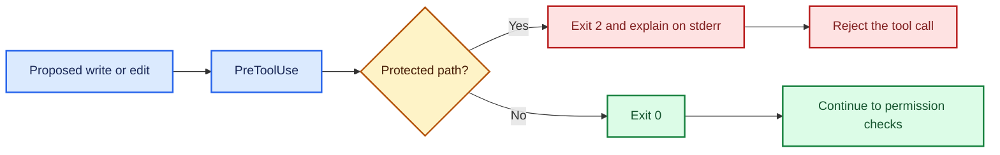
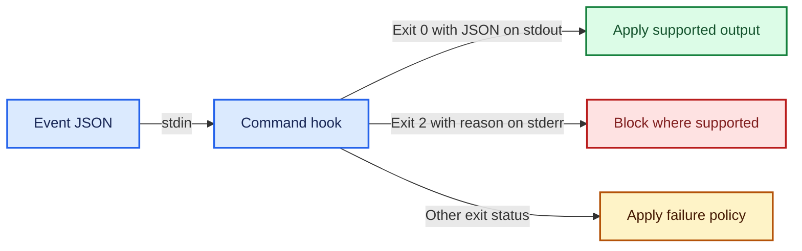

# Automate actions with hooks

Hooks run shell commands or MCP tools at session events. See the
[hooks reference](hooks-reference.md) for event fields and configuration.

## Set up your first hook

1. Add this macOS notification hook to `.synth/hooks.json` in your project.
   Keep any existing event groups.

   ```json
   {
     "Notification": [
       {
         "matcher": "^permission_prompt$",
         "hooks": [
           {
             "type": "command",
             "command": "cat >/dev/null && osascript -e 'display notification \"A tool needs your approval\" with title \"Synth\"'"
           }
         ]
       }
     ]
   }
   ```

2. From the project root, review the command and trust its ID.

   ```console
   synth hooks review
   synth hooks trust <id>
   ```

   In the TUI, use `/hooks review` and `/hooks trust <id>`.
3. In Build mode, set `/approvals ask` and ask Synth to create a scratch file
   with `write`. Expect a notification when the approval card appears.

## What you can automate

Add each recipe's event groups to `.synth/hooks.json`, then review and trust
them as in the [walkthrough](#set-up-your-first-hook).

### Get notified when Synth needs input

Match `^(permission_prompt|agent_needs_input)$` to include questions. For a
Linux desktop, swap in this handler.

```json
{
  "type": "command",
  "command": "cat >/dev/null && notify-send 'Synth' 'Synth needs your input'"
}
```

### Auto-format code after edits

Save the [example formatter](../examples/hooks/format-after-edit.sh) as
`.synth/format-after-edit.sh`. It runs `zig fmt src build.zig` after a successful
edit or write.

```json
{
  "PostToolUse": [
    {
      "matcher": "^(edit|write)$",
      "hooks": [
        { "command": "bash \"$SYNTH_PROJECT_DIR/.synth/format-after-edit.sh\"" }
      ]
    }
  ]
}
```

### Block edits to protected files

1. Save the [path protection script](../examples/hooks/protect-paths.sh) as
   `.synth/protect-paths.sh`. It requires Python 3.
2. Add the hook, then review and trust it.

   ```json
   {
     "PreToolUse": [
       {
         "matcher": "^(write|edit)$",
         "hooks": [
           { "command": "bash \"$SYNTH_PROJECT_DIR/.synth/protect-paths.sh\"" }
         ]
       }
     ]
   }
   ```

3. Ask Synth to create a placeholder `.env` with `write`. The guard checks
   symlink targets too. Shell commands need their own policy.



### Re-inject context after compaction

Run `/compact` in an existing conversation to trigger `SessionStart` with
`source: "compact"` and restore a project instruction.

```json
{
  "SessionStart": [
    {
      "matcher": "^compact$",
      "hooks": [
        {
          "command": "cat >/dev/null && printf '%s\\n' '{\"hookSpecificOutput\":{\"hookEventName\":\"SessionStart\",\"additionalContext\":\"Run zig build test before handing off changes.\"}}'"
        }
      ]
    }
  ]
}
```

### Audit configuration changes

With `jq` installed, edit a [watched file](hooks-reference.md#configchange),
submit a prompt, and check `~/.synth-config-audit.jsonl`.

```json
{
  "ConfigChange": [
    {
      "hooks": [
        {
          "command": "jq -c '{timestamp: (now | todate), source, file_path}' >> \"$HOME/.synth-config-audit.jsonl\""
        }
      ]
    }
  ]
}
```

### React when the directory or a file changes

Try `/cd` within the project or save `README.md` while Synth is open. Check
`.synth/changes.jsonl` in the original project root.

```json
{
  "CwdChanged": [
    {
      "hooks": [
        { "command": "jq -c '{hook_event_name, old_cwd, new_cwd}' >> .synth/changes.jsonl" }
      ]
    }
  ],
  "FileChanged": [
    {
      "matcher": "README.md|docs/usage.md",
      "hooks": [
        { "command": "jq -c '{hook_event_name, event, file_path}' >> .synth/changes.jsonl" }
      ]
    }
  ]
}
```

### Auto-approve specific permission prompts

This hook approves the exact command `pwd`. To test it, set `/approvals ask`
and turn off `auto_approve_safe_commands` in [config.json](configuration.md#files).

```json
{
  "PermissionRequest": [
    {
      "matcher": "^bash$",
      "hooks": [
        {
          "command": "jq -c 'if .tool_input.command == \"pwd\" then {hookSpecificOutput: {hookEventName: \"PermissionRequest\", decision: {behavior: \"allow\"}}} else {} end'"
        }
      ]
    }
  ]
}
```

Protected actions and explicit hook asks still need a person. See the
[permission flow](hooks-reference.md#permissionrequest).

## How hooks work

See the [hook lifecycle](hooks-reference.md#hook-lifecycle) and
[model trust and tier](hooks-reference.md#model-trust-and-tier) in the reference.

### Combine results from multiple hooks

Matching synchronous handlers can run concurrently. Synth merges results in
declaration order, joins context, and picks the strictest permission decision
(`deny` > `ask` > `allow`). Side effects from sibling hooks still happen.

### Read input and return output



Consume stdin even for constant responses. Leave stdout empty on exit 0
for a hook that only has side effects. See the [JSON protocol](hooks-reference.md#hook-input-and-output).

### Filter hooks with matchers

Match the tool name, then inspect arguments in `tool_input` as in the
[permission recipe](#auto-approve-specific-permission-prompts).

### Filter by agent, request purpose, or model

To scope the [example command guard](../examples/hooks/deny-command.sh) to
small and mid-tier subagents, save it as `.synth/deny-command.sh` and add `when`.

```json
{
  "PreToolUse": [
    {
      "matcher": "^bash$",
      "when": { "agent_scope": "subagent", "tier": ["small", "mid"] },
      "hooks": [
        { "command": "bash \"$SYNTH_PROJECT_DIR/.synth/deny-command.sh\"" }
      ]
    }
  ]
}
```

See [matchers and filters](hooks-reference.md#matcher-patterns).

### Configure hook location

Use `.synth/hooks.json` for a project or `~/.synth/hooks.json` for all projects.
See all [hook locations and formats](hooks-reference.md#hook-locations).

## Limitations and troubleshooting

| Symptom | What to check |
| --- | --- |
| Prompt blocked pending review | Use `/hooks review` to identify the matching policy hook, trust or disable it, then resubmit. |
| Hook never fires | Check the event name, matcher, `when`, trust, and enabled state. A `FileChanged` watcher needs explicit paths. |
| `/hooks` lists no hooks | Check the file location and ensure event keys map to arrays of groups. A standalone file accepts the event map directly or under `hooks`. |
| Hook failed or timed out | Check `/hooks list` for recent runs, then check `PATH`, the script path, and the effective timeout. |
| JSON has no effect | Exit 0 and write only one object to stdout. Set `hookEventName` to the triggering event and check the fields that event accepts. |

## Learn more

- [MCP tool hooks](hooks-reference.md#mcp-tool-hook-fields)
- [HTTP adapters](hooks-reference.md#http-adapters)
- [Example scripts](../examples/hooks)
